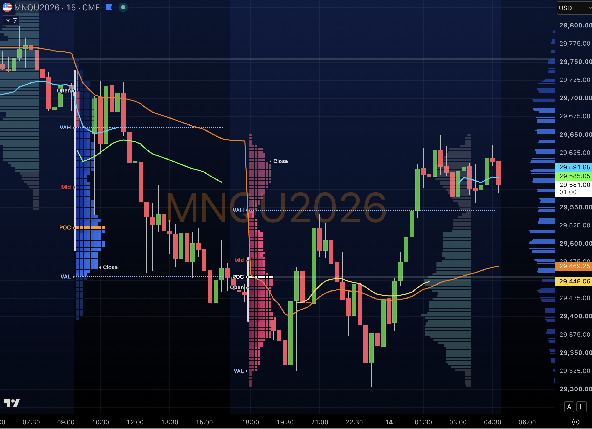
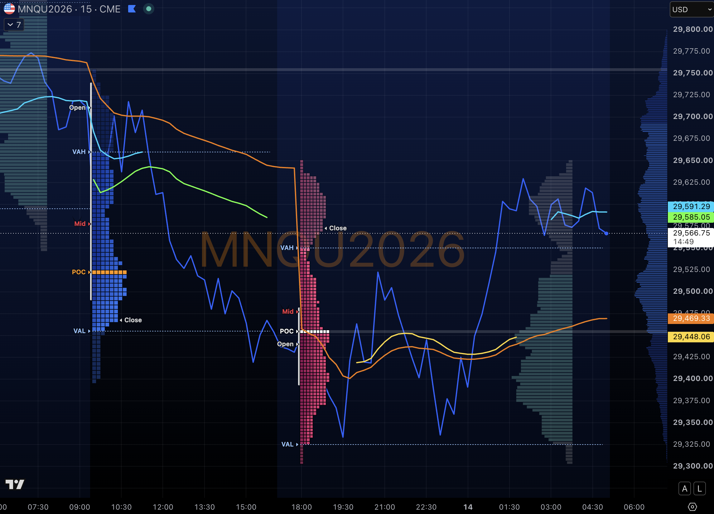

# "RTH Session VWAP" Indicator - TradingView Pine Script 

A TradingView (Pine Script **v6**) indicator that plots timezone-correct session VWAPs
(New York, Europe, Asia) plus a continuous 24h/daily VWAP, with optional standard-deviation bands.

Built for intraday futures trading where the chart is viewed from a timezone that differs
from the exchange — the sessions compute in explicit market timezones, so they plot correctly
no matter what timezone your chart is set to (e.g. Manila), and daylight saving is handled
automatically.

- **TradingView Script** https://www.tradingview.com/script/baqDrdPW-RTH-Session-VWAP/
- **Website:** https://raoulsson.com
- **Repo:** https://github.com/raoulsson/trading-view-script-rth-session-wvap
- **Latest changes:** [`CHANGELOG.md`](./CHANGELOG.md)

## Screenshots

MNQ (Micro E-mini Nasdaq) 15m — session VWAPs with a volume-profile overlay for context.
The NY VWAP anchors to 09:30 ET; the 24h VWAP runs continuously across the trading day.





## Attribution

This is a modified derivative of **"Koalafied VWAP Session/Day"** (published as *Session VWAP*)
by **TJ_667**, released under the Mozilla Public License 2.0. All original credit goes to TJ_667.
This project keeps the same MPL-2.0 license (see [`LICENSE`](./LICENSE)).

## What changed vs. the original

- **Timezone-correct sessions.** Each session is computed in an explicit timezone
  (`America/New_York`, `Europe/London`, `Asia/Tokyo`) via the timezone argument of `time()`.
  An omitted timezone uses the instrument's exchange timezone; explicit market zones keep the
  intended session hours consistent across instruments and handle DST automatically. Changing
  only the chart's display timezone does not change Pine calculations.
- **New York = RTH.** The NY session defaults to the regular cash session, **09:30–16:00 ET**,
  so the NY VWAP anchors to the 09:30 open.
- **Pine v6 migration.** `time()` results (int-or-`na`) are converted to real booleans, since v6
  removed implicit `int`/`float` → `bool` casting; the daily reset uses an explicit boolean
  condition rather than a numeric one.
- **Daily VWAP.** A VWAP line anchored to the trading day (24h/Globex), drawn independently of
  the session VWAPs and visible by default.
- **Per-session config blocks.** Each session (Asia, Europe, NY) is one block: a dropdown that sets
  the timezone **and** its hours, a per-session **Use custom hours** checkbox, and a custom from-to
  field applied only when that checkbox is on.
- **Visible defaults.** Daily, Asia, Europe, and New York VWAP lines and their main value labels
  are all enabled by default. Each has an independent show switch.
- **Presets.** Line colors and width preset (Asia yellow, Europe cyan, NY green, Daily amber),
  main VWAP labels on by default, standard-deviation bands off by default.
- **Clean legend.** All inputs and helper plots are hidden from the status line, so the chart
  legend stays uncluttered while the values remain in the Data Window and Inputs tab.

## Installation

Two ways to get it on your chart:

**A) Update your saved script from this repo**

1. Open [`rth-session-vwap.pine`](./rth-session-vwap.pine) and copy the full file.
2. In TradingView, open your saved **RTH Session VWAP** in Pine Editor, replace its source, and save.
3. To apply the new defaults on an existing chart, remove its old VWAP instance and add the updated
   one. TradingView can retain saved inputs for an instance when its source is replaced; source
   defaults do not overwrite those saved values.

**B) Add from source as a separate script**

1. Grab the Pine code &mdash; either copy the contents of
   [`rth-session-vwap.pine`](./rth-session-vwap.pine) directly, or clone the repo:
   ```
   git clone https://github.com/raoulsson/trading-view-script-rth-session-wvap.git
   ```
2. In TradingView, open **Pine Editor**, paste the code, and click **Add to chart**.
3. If you had a previous version loaded, open the indicator settings and use
   **Defaults → Reset settings** (or remove and re-add) so the presets take effect.

## Settings

<pre>
Sessions & timezone behaviour
─────────────────────────────
Each session (Asia, Europe, NY) is one block:
  • Zone & preset hours — a dropdown that sets the timezone AND default hours,
                          e.g. "America/New York (0930-1600, default)".
  • Use custom hours    — a checkbox; when on, the Custom hours field below
                          replaces the dropdown hours (read in the same zone).
  • Custom hours        — your own from-to session window.

Hours are read in the session's OWN market timezone, not your chart timezone —
they are passed explicitly to Pine's time():

    tNY = time(timeframe.period, NY_session_full + ':1234567', tzNY)

Consequences:
  • 0930-1600 always means New York local wall-clock — whether your chart is
    set to Manila, UTC, or anything else.
  • Daylight saving is handled automatically; you never re-enter hours in spring/fall.
  • Zones are a curated dropdown of real IANA names (e.g. Asia/Hong Kong,
    Europe/Berlin, America/Chicago). Only genuine IANA identifiers work — a
    non-IANA name such as "Europe/Frankfurt" (Germany is Europe/Berlin) errors,
    so pick from the list.

Defaults: Asia = Asia/Tokyo 0800-1700 · Europe = Europe/London 0800-1630 ·
          NY = America/New York 0930-1600 (RTH cash session).

The Asia preset uses the common NQ futures convention: Globex reopen through roughly the London
open, rather than Tokyo cash-equity hours. Tokyo has no daylight saving time. The fixed 0800-1700
Tokyo window maps to 0700-1600 Manila during US winter time; when US daylight saving is active,
shift the Tokyo window one hour earlier (0700-1600) if you want it to track the New York-anchored
Globex reopen. Session naming varies by market; choose a different preset or custom hours if you
use another definition of Asia.
</pre>

- **Display:** Daily and session VWAP toggles, main value-label toggles (all on by default), and
  per-session + Daily std-dev band toggles (off by default).
- **Asia / Europe / NY Session:** zone+hours dropdown, "Use custom hours" checkbox, custom hours field.
- **Calculation:** std-dev multipliers, VWAP source (applies to all VWAPs), label offset.

## Notes

- "24h/Daily" resets when the chart's `time("1D")` changes. For CME futures with the full
  electronic session, this follows the exchange trading-day boundary. It uses only available
  chart bars: on an RTH-only chart it cannot include overnight volume. Its first loaded day
  starts at the first available bar, so load the full trading day for a complete value.
- Session VWAPs reset at each configured local opening even when a session-only chart omits
  the intervening off-session bars. Custom overnight and 24-hour windows stay in one occurrence
  across midnight and reset at their configured opening. IANA calendar dates handle DST and
  month/year changes; no fixed 24-hour subtraction is used.
- A session first loaded partway through starts from that available bar, matching the original
  behavior. It is a partial-session value until a later complete session is available. These
  calculations use whole chart bars; choose an intraday timeframe aligned to the session's
  opening/closing times for accurate boundaries. Coarse bars are not split into intrabars.
- VWAP requires reported volume. Zero-volume bars add no weight; the first positive-volume bar
  initializes valid bands even after initial zero-volume bars. Missing volume makes that
  occurrence's VWAP and bands unavailable until the next session reset. No unweighted or
  invented-volume fallback is used; a feed without volume cannot produce VWAP.
- Plots stack back-to-front as **Daily, Asia, Europe, New York**. Each family includes its
  optional bands, with its main VWAP above those bands. All four main VWAPs and their labels are
  enabled by default; the standard-deviation bands remain off until enabled.
  The declaration uses `explicit_plot_zorder = true`, so Pine follows the written plot order.
  Label contents/visibility and all source plot styles remain unchanged; this orders this
  indicator's plots, not other chart indicators.
- Std-dev bands are off by default; enable them under Display.

## Reset-fix validation

Version `2026.11.04-2200` fixes consecutive-session resets on RTH-only charts and initializes
Daily VWAP on its first available bar. All three timezone sessions use the same occurrence rule.
Version `2026.11.04-2230` adds the explicit complete-family plot order described above, while
preserving each calculation and individual plot/label expression. Local tests port the Pine formulas and compare them with independent calendar and weighted-price
oracles, including a captured TradingView NQ 30m dataset across the November 2026 DST change:

```sh
python3 -m unittest discover -s tests -v
```

These are formula/replay checks, not a Pine compilation or chart-rendering test. Compile the
updated source in TradingView and verify the applied chart instance before treating runtime
behavior as checked. Saved chart Style overrides after the plot reorder have not been visually
verified.

## License

Mozilla Public License 2.0 — see [`LICENSE`](./LICENSE).
Original © TJ_667. Modifications © 2026 raoulsson.
